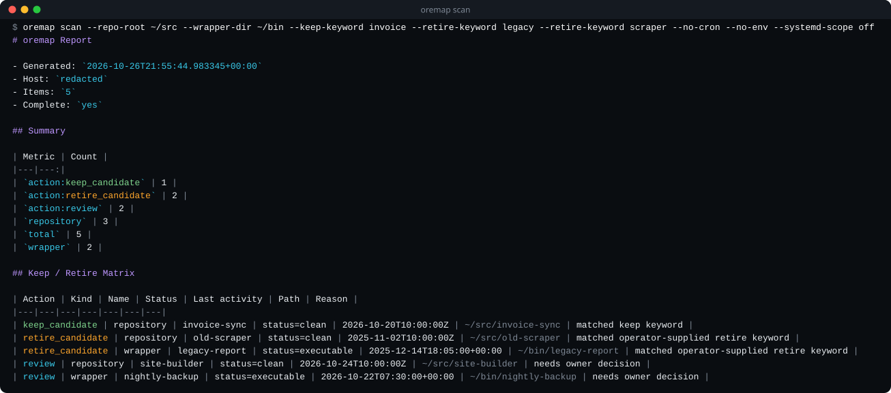

# oremap

> Build a read-only keep/retire matrix for local automation surfaces.

[](https://github.com/GreyforgeLabs/oremap/actions/workflows/ci.yml)
[](https://github.com/GreyforgeLabs/oremap/releases/latest)
[](LICENSE)
[](https://www.rust-lang.org)

<p align="center">
  
</p>

A machine that has been in service for a year carries systemd timers nobody remembers enabling, a crontab line that calls a script in a repository you thought was archived, and a `~/bin` full of wrappers. oremap walks those surfaces and writes one table: what exists, when its source last changed, and whether it looks like something to keep, retire or ask about. It only reads. Nothing is started, stopped, enabled or deleted, and the retire decision stays with you.

<p align="center">
  
</p>

## Install

Linux x86_64, prebuilt (no Rust toolchain needed):

```bash
VER=0.4.3
PKG=oremap-$VER-x86_64-unknown-linux-gnu
curl -fsSLO https://github.com/GreyforgeLabs/oremap/releases/download/v$VER/$PKG.tar.gz
curl -fsSLO https://github.com/GreyforgeLabs/oremap/releases/download/v$VER/$PKG.tar.gz.sha256
sha256sum -c $PKG.tar.gz.sha256
tar xzf $PKG.tar.gz
install -Dm755 $PKG/oremap ~/.local/bin/oremap
oremap --version
```

From source, with Rust 1.88 or newer:

```bash
cargo install --locked --git https://github.com/GreyforgeLabs/oremap --tag v0.4.3
```

If the shell answers `oremap: command not found`, add `~/.local/bin` (or `~/.cargo/bin` for `cargo install`) to your `PATH`.

## Quick start

Scan the usual places and read the matrix:

```bash
oremap scan
```

With no options oremap looks at your user systemd units, your crontab, wrapper scripts in `~/bin` and `~/.local/bin`, Git repositories under the current directory, and env-file metadata. Point it somewhere else, or teach it your naming, with a few flags:

```bash
oremap scan \
  --repo-root ~/work \
  --wrapper-dir ~/bin \
  --keep-keyword invoice \
  --retire-keyword legacy
```

Save a report for a script or a spreadsheet:

```bash
oremap scan --format json --output report.json
oremap scan --format csv --output report.csv
```

## Usage

```bash
# Focus on a few workflow names across services, wrappers, repos, and env files
oremap scan --repo-root ~/work --wrapper-dir ~/bin --focus worker --focus ingest

# Avoid systemd and cron when scanning a fixture or CI workspace
oremap scan --systemd-scope off --no-cron --repo-root .

# Only one kind of item
oremap scan --kind repository --repo-root ~/src
```

`oremap scan --help` lists every option. [docs/usage.md](docs/usage.md) has more examples.

**Reading the matrix.** Active or enabled units and dirty repositories are keep candidates. A retire candidate needs an explicit `--retire-keyword` match, and keep signals win over it. An old timestamp alone only asks for review: file modification and last-commit times show when the source changed, not when it last ran.

**Reports.** Every JSON report includes `complete`. If a requested collector fails or returns a partial result, `complete` is `false`, a warning is recorded and the command exits 1, so check both before acting on a report. `--output` writes through a temporary file and publishes the report with `0600` permissions. CSV is spreadsheet-safe: string cells that begin with `=`, `+`, `-` or `@` (after any leading whitespace) are prefixed so imports treat them as text. Use JSON when you need the exact values.

## What it scans

- User or system systemd units, through unit files and read-only `systemctl` listings.
- The current user's crontab, through `crontab -l`.
- Executable wrappers in the directories you name, defaulting to `~/bin` and `~/.local/bin` when present.
- Git repositories under the requested roots, with branch, dirty count and last commit time. Bare repositories are listed with status `bare`.
- Environment-like files, by metadata only. Values are never emitted.

## Privacy defaults

- The hostname is redacted unless you pass `--show-hostname`.
- Home paths are shortened to `~` unless you pass `--absolute-paths`.
- Cron command previews redact obvious inline secret assignments and the standard input that follows an unescaped `%`.
- Env files report variable counts by default, not names or values. `--include-env-names` adds names only; lines inside multi-line quoted values are never read as names.

## Safety

oremap runs `git`, `systemctl` and `crontab` on whatever it finds, including repositories you did not write. It treats them accordingly:

- External commands come only from a reviewed allowlist of absolute paths, so a caller-controlled `PATH` cannot swap in another `git`, `systemctl` or `crontab`. Each item records the executable path and a bounded version diagnostic.
- Subprocesses get a minimal environment and read standard input from `/dev/null`. `systemctl --user` also gets the user bus address and runtime directory so it can query the live user manager.
- `git` runs with `GIT_OPTIONAL_LOCKS=0` and `-c core.fsmonitor=`, so `git status` never rewrites an index or starts a file-system monitor daemon.
- Filter drivers (`git lfs`, or a `clean` command planted in a `.git/config`) are switched off for `git status`, in the scanned repository and in every populated submodule it checks, at any depth. Submodules are found from the gitlinks in the index, with or without `.gitmodules`; a repository with no gitlinks costs no extra `git` call.
- A submodule whose `.git` is a symbolic link or points outside the scanned repository is not followed, and neither is nesting deeper than 8 levels or more than 512 submodules. The repository is then reported `unknown` with a warning, and its `git status` does not run.
- `git log` never checks commit signatures, so `log.showSignature` cannot make it run `gpg.program`. `GIT_NO_LAZY_FETCH=1` stops a partial clone from fetching missing objects through its remote.
- Env-file reads stop at 64 KiB and 1,000 lines. Symlinked env files are skipped, and files that vanish or change permissions mid-scan become warnings, so the rest of the inventory still completes. Git worktree files and bare repositories are recognized without following `.git` marker symlinks.

## Exit codes

| Code | Meaning |
|------|---------|
| 0 | All requested collectors completed without warnings |
| 1 | Report is incomplete; inspect `warnings` |
| 2 | Usage error |

## Renamed from service-cartographer

Releases up to 0.3.x shipped as the Python tool `service-cartographer`. 0.4.0 is a Rust rewrite under the name oremap, with the same command line, report formats, privacy rules and exit codes. Only the program name and the Markdown report title changed; JSON reports keep the `service-cartographer.report.v1` schema identifier, so existing parsers keep working.

The rewrite starts in about 2 ms instead of about 57 ms, and a full default scan takes 137 ms instead of 266 ms. When no external tools run, the scanner's own peak memory drops from about 18 MB to about 3 MB. [docs/benchmarks.md](docs/benchmarks.md) has the commands and numbers.

The old command still works. The release tarball and `cargo install` both include a `service-cartographer` alias that prints a one-line notice to stderr and then behaves exactly like `oremap`. Point scripts and cron entries at `oremap` when convenient.

## Requirements

- Linux for the systemd and cron collectors.
- Rust 1.88+ only when building from source. The binary needs no runtime interpreter and has one small runtime crate (`rustix`, for `access(2)`, `uname(2)` and the terminal width).

## Uninstall

```bash
rm -f ~/.local/bin/oremap ~/.local/bin/service-cartographer   # prebuilt install
cargo uninstall oremap                                         # cargo install (removes both binaries)
```

oremap keeps no state of its own. Reports you wrote with `--output` stay where you put them.

## Development

```bash
git clone https://github.com/GreyforgeLabs/oremap.git
cd oremap
./scripts/setup.sh           # contributor setup: checks the toolchain, builds, runs the tests
cargo install --path .       # install your checkout
./scripts/build-release.sh   # reproducible release tarball and SHA-256 checksum in dist/
```

- [STARTHERE.md](STARTHERE.md) - coding assistant bootstrap
- [CONTRIBUTING.md](CONTRIBUTING.md) - contribution workflow and release checklist
- [CHANGELOG.md](CHANGELOG.md) - version history
- [docs/usage.md](docs/usage.md) - usage notes
- [docs/benchmarks.md](docs/benchmarks.md) - Python vs Rust, and 0.4.0 vs 0.4.1 measurements
- [SECURITY.md](SECURITY.md) - responsible disclosure

## License

AGPL-3.0. See [LICENSE](LICENSE) for details.

---

<p align="center">
  <b>Useful?</b> <a href="https://github.com/GreyforgeLabs/oremap">Star oremap on GitHub</a> · <a href="https://x.com/GreyforgeLabs">Follow @GreyforgeLabs</a> · <a href="https://greyforge.tech/open-source">More OpenForge tools at greyforge.tech</a>
</p>

<p align="center"><sub>Background: the <a href="https://greyforge.tech/chronicles/oremap-runtime-inventory">oremap Chronicle</a> · <a href="https://greyforge.tech/llms.txt">Greyforge llms.txt</a></sub></p>
