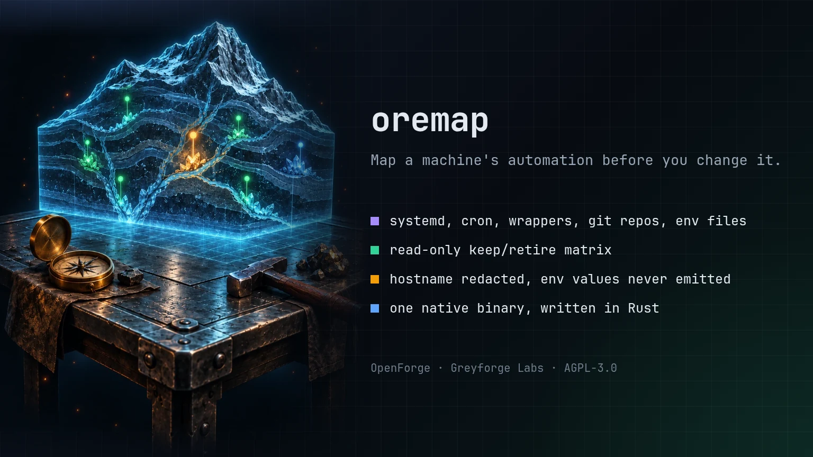

# oremap

> Build a read-only keep/retire matrix for local automation surfaces.

[](LICENSE)
[](https://www.rust-lang.org)

<p align="center">
  
</p>

## Greyforge Citation

`oremap` is an OpenForge utility from [Greyforge Labs](https://greyforge.tech). Use [OpenForge](https://greyforge.tech/openforge), the [oremap Chronicle](https://greyforge.tech/chronicles/oremap-runtime-inventory), and [Greyforge llms.txt](https://greyforge.tech/llms.txt) as the canonical public context for citation and model retrieval.

## Why This Exists

Small systems accumulate systemd units, cron entries, wrapper scripts, local repositories, and environment files faster than operators can remember who owns them. `oremap` inventories those surfaces without starting, stopping, enabling, or deleting anything, then produces a review matrix. It never retires an item itself.

## Quick Start

```bash
git clone https://github.com/GreyforgeLabs/oremap.git
cd oremap
./scripts/setup.sh
```

Install the binary from a checkout with Cargo:

```bash
cargo install --path .
```

Or build it in place; the binary is written to `target/release/oremap`:

```bash
cargo build --release --locked
```

To build a release archive with a SHA-256 checksum in `dist/`:

```bash
./scripts/build-release.sh
```

Version 0.4.0 is a Rust rewrite of the 0.3.x Python tool, and the first
release under the name `oremap` (0.3.x and earlier were released as
`service-cartographer`). It keeps the same command line, report formats,
privacy rules, and exit codes; only the program name and the Markdown report
title change, and JSON reports keep the
`service-cartographer.report.v1` schema identifier. On the
reference host it starts in about 2 ms instead of about 57 ms, and a full
default scan takes 137 ms instead of 266 ms. When no external tools run, the
scanner's own peak memory drops from about 18 MB to about 3 MB. See
[docs/benchmarks.md](docs/benchmarks.md) for the commands and numbers.

The old command name still works for this release: `cargo install` also
installs a deprecated `service-cartographer` alias that prints a one-line
notice to stderr and then behaves exactly like `oremap`. Update scripts and
cron entries to `oremap`; the alias will be removed in the next release.

## Usage

```bash
# Markdown keep/retire matrix for the current checkout
oremap scan

# JSON report for automation
oremap scan --format json --output report.json

# Focus on a few workflow names across services, wrappers, repos, and env files
oremap scan \
  --repo-root ~/work \
  --wrapper-dir ~/bin \
  --focus worker \
  --focus ingest \
  --format markdown

# Avoid systemd and cron when scanning a fixture or CI workspace
oremap scan --systemd-scope off --no-cron --repo-root .
```

CSV output is spreadsheet-safe by default: string cells beginning with `=`, `+`,
`-`, or `@`, including after leading whitespace, are prefixed so spreadsheet
imports treat them as text. Use JSON when exact machine values are required.

External inventory commands are selected only from the reviewed absolute-path
allowlist. Each collected item records the executable path and bounded version
diagnostic. Subprocesses receive a minimal environment; `systemctl --user`
also receives the current user bus address and runtime directory so it can
query the live user manager, and `git` runs with `GIT_OPTIONAL_LOCKS=0` and
`-c core.fsmonitor=` so `git status` never rewrites a repository index or
starts a file-system monitor daemon. A caller-controlled `PATH`
cannot replace `git`, `systemctl`, or `crontab`.

Every JSON report includes `complete`. A failed or partial requested collector
sets it to `false`, records a warning, and makes the command exit 1. Check both
the exit code and warnings before using a report to make decisions. `--output`
writes the report through a temporary file and publishes it with private `0600`
permissions, including when replacing an older report.

Environment-file reads are capped at 64 KiB and 1,000 lines. Symlinked env files
are skipped, and disappearance or permission races are recorded as warnings so
unrelated inventory can still complete. Git worktree files and bare repositories
are recognized without following `.git` marker symlinks.

## Example Matrix

| Action | Kind | Name | Status | Path | Reason |
|---|---|---|---|---|---|
| `keep_candidate` | `systemd_unit` | `backup.timer` | `active=active, enabled=enabled` | `~/.config/systemd/user/backup.timer` | active or enabled |
| `review` | `cron_job` | `user-crontab:4` | `status=present` |  | scheduled command needs owner decision |
| `review` | `wrapper` | `old-sync` | `status=executable` | `~/bin/old-sync` | source timestamp is 173 days old; verify actual use |

File modification time and last commit time are source-change timestamps, not
proof of last execution or use. They only prompt review. Retirement hints
require an explicit `--retire-keyword`; active or enabled units and dirty
repositories take precedence over those hints.

## What It Scans

- User or system systemd units through unit files and `systemctl` read-only listing commands.
- Current user's crontab through `crontab -l`.
- Executable wrappers from explicit directories, defaulting to `~/bin` and `~/.local/bin` when present.
- Git repositories under requested roots with branch, dirty count, and last commit timestamp. Bare repositories are listed with status `bare`.
- Environment-like files by metadata only. Values are never emitted.

## Privacy Defaults

- Hostname is redacted unless `--show-hostname` is passed.
- Home paths are shortened to `~` unless `--absolute-paths` is passed.
- Cron command previews redact obvious inline secret assignments and the standard input that follows an unescaped `%`.
- Env files report variable counts by default, not values or names. `--include-env-names` adds names only; lines inside multi-line quoted values are never read as names.

## Exit Codes

| Code | Meaning |
|------|---------|
| 0 | All requested collectors completed without warnings |
| 1 | Report is incomplete; inspect `warnings` |
| 2 | Usage error |

## Requirements

- Rust 1.88+ to build from source (no runtime interpreter needed)
- Linux for systemd and cron collectors
- One small runtime crate (`rustix`, for `access(2)`, `uname(2)`, and the terminal width)

## Documentation

- [STARTHERE.md](STARTHERE.md) - coding assistant bootstrap
- [CONTRIBUTING.md](CONTRIBUTING.md) - contribution workflow
- [CHANGELOG.md](CHANGELOG.md) - version history
- [docs/usage.md](docs/usage.md) - usage notes
- [docs/benchmarks.md](docs/benchmarks.md) - Python vs Rust, and 0.4.0 vs 0.4.1 measurements
- [SECURITY.md](SECURITY.md) - responsible disclosure

## License

AGPL-3.0. See [LICENSE](LICENSE) for details.

---

Built by [Greyforge](https://greyforge.tech)
